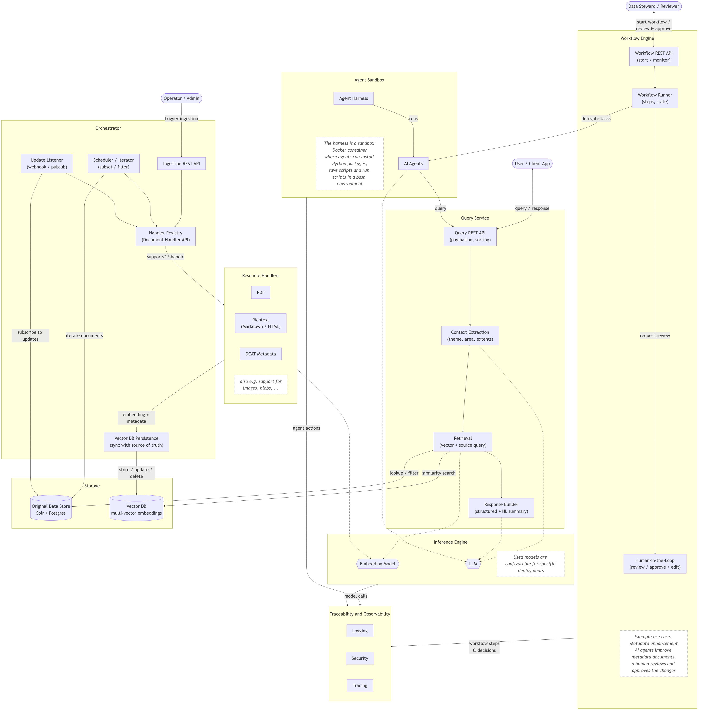

# GeoAI Engine

The GeoAI Engine adds AI capabilities to existing (geo)data platforms. It keeps a vector database in sync with an existing data store, enabling natural-language search with LLM-generated answers, and provides AI-assisted workflows in which sandboxed AI agents work under human review.

## Key Concepts

### Semantic search alongside an existing data store

The original data store (e.g. Solr or Postgres) remains the source of truth. The GeoAI Engine runs a vector database alongside it and keeps both consistent:

* **Orchestrator**: iterates through the documents of the original data store or listens for updates, and manages ingestion into the vector database
* **Resource Handlers**: create vector embeddings and brief metadata (title, description, spatial and temporal extent) for specific resource types, such as PDF, rich text (Markdown / HTML) and DCAT metadata, and can be extended to e.g. images or blobs
* **Query Service**: combines vector search and queries against the original data store. An LLM derives context from user prompts (e.g. theme, application area, spatial and temporal extent) and creates natural-language responses, including summaries of the found datasets and suggestions for digging deeper

### AI-assisted workflows

Orthogonal to search, the GeoAI Engine supports workflows in which AI agents carry out tasks:

* **Workflow Engine**: runs workflows, delegates tasks to AI agents and supports a human in the loop who reviews, edits and approves the results. Example use case: enhancing metadata documents
* **Agent Sandbox**: runs AI agents in an isolated Docker container, where they can install Python packages and save and run scripts in a bash environment

### Shared components

* **Inference Engine**: provides the embedding model and the LLM. The models used are configurable for specific deployments
* **Traceability and Observability**: logging, security and tracing of agent actions, model calls and workflow decisions

## Use Cases

The GeoAI Engine is applied in the research project **velocityAdapt**, funded by the German Federal Ministry of Research, Technology and Space (BMFTR), in which SDIs are extended into urban digital twins (uDT) through co-design. Example application areas include heat stress, urban development and resilience against heavy rainfall. The development is accompanied by the network initiative **"GeoAI Metadata"** (including the GDI-DE coordination office, Schleswig-Holstein, Saxony, North Rhine-Westphalia, con terra and 52°North).

### Metadata enhancement

An open-source, AI-assisted tool reads and checks metadata records and prepares suggestions for improvement, which domain experts review and approve (human in the loop). This systematically improves metadata quality and completeness, immediately improves the findability of relevant data, and saves considerable time when managing large amounts of metadata.

### Semantic geodata search

The GeoAI Engine addresses limitations of classic SDI search patterns by applying semantic search: metadata is extracted from the uDT, converted into vectors with an open-source embedding model and stored in a vector database (Qdrant), complemented by a spatial index for geographic operations. An LLM evaluates the search results and recommends suitable datasets. Users and AI agents alike can describe the data they need in natural language and find relevant datasets even when the keywords do not match exactly.

## Development

Parts of the architecture have already been developed and are currently undergoing testing and review before being release under an Open Source license. The remaining components, e.g. the Agent Sandbox, Traceability and Observability and the Query Service, are currently under development.